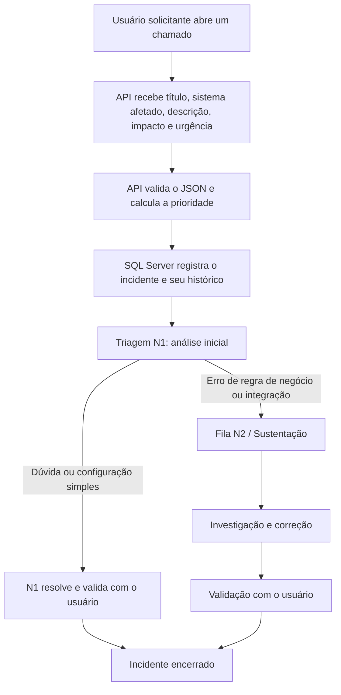

# DeskHub

O **DeskHub** é uma API REST de estudos inspirada no fluxo de gestão de incidentes de ferramentas como o ServiceNow.

O projeto foi criado para praticar, de forma simples e progressiva:

- desenvolvimento backend com Node.js e Express;
- criação de rotas HTTP;
- envio e validação básica de dados em JSON;
- conexão entre uma API e o SQL Server;
- consultas SQL parametrizadas;
- modelagem de usuários, incidentes e histórico;
- criação de novas ocorrências por meio de uma requisição `POST`;
- uso de Docker para executar o banco de dados localmente.

> Este é um projeto educacional, ainda em desenvolvimento. Ele não é uma implementação oficial do ServiceNow e não deve ser usado como sistema de produção.

## Como o DeskHub funciona

Atualmente, o usuário envia uma ocorrência para a API. A API valida os campos principais, calcula a prioridade usando impacto e urgência e registra o incidente no SQL Server com o status inicial `new`.

```text
Usuário
   │
   │ envia um JSON para POST /api/incidents
   ▼
API REST — Node.js + Express
   │
   │ valida os campos e calcula a prioridade
   ▼
SQL Server
   │
   │ armazena o incidente com status inicial "new"
   ▼
Incidente criado — exemplo: INC0000001
```

O status interno `new` representa um chamado novo, ainda aguardando a análise inicial.

## Fluxo que o projeto pretende simular

O objetivo de evolução do DeskHub é representar um fluxo simples de atendimento N1 e N2:



No estado atual do projeto, a abertura do incidente já funciona. A triagem N1, o escalonamento N2, as mudanças de status e a gravação automática do histórico serão implementados nas próximas etapas.

## Prioridade do incidente

O cliente não informa a prioridade diretamente. Ele envia o impacto e a urgência, usando valores de `1` a `3`, e o backend calcula a prioridade.

| Impacto / Urgência | 1 — Alta | 2 — Média | 3 — Baixa |
|---|---:|---:|---:|
| 1 — Alto | P1 | P2 | P3 |
| 2 — Médio | P2 | P3 | P4 |
| 3 — Baixo | P3 | P4 | P4 |

Exemplo: impacto `2` e urgência `1` resultam em prioridade `P2`.

## Tecnologias utilizadas

- **Node.js:** executa o backend;
- **Express:** cria as rotas e recebe as requisições HTTP;
- **SQL Server:** armazena usuários, incidentes e histórico;
- **mssql:** conecta o Node.js ao SQL Server;
- **Docker e Docker Compose:** executam o SQL Server localmente;
- **dotenv:** carrega as variáveis do arquivo `.env`;
- **Thunder Client:** pode ser usado para testar as rotas dentro do VS Code.

## Estrutura do projeto

```text
desk-hub/
├── backend/
│   ├── config/
│   │   └── database.js
│   ├── database/
│   │   └── migrations/
│   │       ├── 001_create_users.sql
│   │       ├── 002_create_incidents.sql
│   │       └── 003_create_incident_history.sql
│   ├── src/
│   │   ├── app.js
│   │   └── server.js
│   ├── .env.example
│   ├── .gitignore
│   ├── docker-compose.yml
│   └── package.json
└── README.md
```

## Banco de dados

O banco possui três tabelas principais.

### `users`

Armazena os usuários do sistema:

- solicitante (`requester`);
- atendente (`agent`);
- administrador (`admin`).

### `incidents`

Armazena os chamados, incluindo:

- número do incidente, como `INC0000001`;
- título e descrição;
- categoria ou sistema afetado;
- impacto e urgência;
- prioridade calculada;
- status;
- solicitante e atendente responsável;
- datas de criação, atualização, resolução e fechamento.

### `incident_history`

Foi preparada para registrar a trilha de mudanças de cada incidente, como alteração de status, atribuição de atendente, resolução e encerramento.

A tabela já existe, mas a rota de criação ainda não grava o histórico automaticamente.

## Como executar o projeto

### Pré-requisitos

Tenha instalado:

- Node.js;
- npm;
- Docker;
- Docker Compose.

### 1. Acesse o backend

```bash
cd backend
```

### 2. Instale as dependências

```bash
npm install
```

### 3. Configure o ambiente

Crie o `.env` a partir do exemplo:

```bash
cp .env.example .env
```

Preencha uma senha forte em `DB_PASSWORD`:

```env
PORT=3000

DB_SERVER=localhost
DB_PORT=1433
DB_NAME=deskhub
DB_USER=sa
DB_PASSWORD=sua_senha_forte
DB_ENCRYPT=false
DB_TRUST_SERVER_CERTIFICATE=true
```

O arquivo `.env` contém informações locais e não deve ser enviado ao GitHub.

### 4. Inicie o SQL Server

```bash
docker compose up -d
```

Confira o container:

```bash
docker compose ps
```

### 5. Crie o banco `deskhub`

Entre no SQL Server:

```bash
docker exec -it deskhub-sqlserver \
  /opt/mssql-tools18/bin/sqlcmd \
  -S localhost \
  -U sa \
  -d master \
  -C
```

Digite a senha definida no `.env` e execute:

```sql
CREATE DATABASE deskhub;
GO
EXIT
```

Se o banco já existir, não execute novamente o `CREATE DATABASE`.

### 6. Execute as migrations

Ainda dentro da pasta `backend`, execute:

```bash
for migration in database/migrations/*.sql; do
  docker compose exec -T sqlserver sh -c \
    '/opt/mssql-tools18/bin/sqlcmd -S localhost -U sa -P "$MSSQL_SA_PASSWORD" -C -d master -b' \
    < "$migration"
done
```

As migrations criam as tabelas na ordem correta. Elas também podem ser executadas novamente sem recriar tabelas que já existem.

### 7. Cadastre um solicitante

Um incidente precisa estar relacionado a um usuário existente. Entre novamente no SQL Server, agora usando o banco `deskhub`:

```bash
docker exec -it deskhub-sqlserver \
  /opt/mssql-tools18/bin/sqlcmd \
  -S localhost \
  -U sa \
  -d deskhub \
  -C
```

Cadastre um usuário de estudo:

```sql
INSERT INTO dbo.users (name, email, role)
OUTPUT INSERTED.id, INSERTED.name, INSERTED.role
VALUES (N'Usuário de estudo', N'usuario@deskhub.local', 'requester');
GO
EXIT
```

Guarde o ID retornado. Ele será usado como `requesterId` na requisição.

### 8. Inicie a API

```bash
npm run dev
```

Resultado esperado:

```text
Conectado ao SQL Server
DeskHub API executando na porta 3000
```

## Rotas disponíveis

### Verificar a API

```http
GET /
```

Resposta:

```json
{
  "ok": true,
  "servico": "Desk-Hub API"
}
```

### Criar um incidente

```http
POST /api/incidents
Content-Type: application/json
```

Exemplo de Body JSON:

```json
{
  "title": "Sistema financeiro indisponível",
  "description": "O sistema apresenta uma tela em branco durante o acesso.",
  "category": "Sistema financeiro",
  "impact": 2,
  "urgency": 1,
  "requesterId": 2
}
```

Troque o `requesterId` pelo ID de um usuário que exista na tabela `users`.

Resposta esperada com status `201 Created`:

```json
{
  "id": 1,
  "incident_number": "INC0000001",
  "title": "Sistema financeiro indisponível",
  "description": "O sistema apresenta uma tela em branco durante o acesso.",
  "category": "Sistema financeiro",
  "impact": 2,
  "urgency": 1,
  "priority": "P2",
  "status": "new",
  "requester_id": 2,
  "created_at": "2026-11-24T03:00:00.000Z"
}
```

## Testando no Thunder Client

1. Abra o Thunder Client no VS Code.
2. Crie uma nova requisição.
3. Selecione o método `POST`.
4. Use a URL `http://localhost:3000/api/incidents`.
5. Em **Body**, selecione **JSON**.
6. Cole o exemplo de requisição.
7. Confirme o header `Content-Type: application/json`.
8. Clique em **Send**.

## Próximas etapas de estudo

- registrar automaticamente a criação no histórico;
- consultar todos os incidentes com uma rota `GET`;
- consultar um incidente pelo ID;
- atribuir o incidente a um atendente N1;
- alterar o status do incidente;
- escalar incidentes para uma fila N2;
- registrar resolução e encerramento;
- adicionar testes automatizados;
- separar a aplicação em rotas, serviços e acesso ao banco quando o projeto crescer;
- criar uma interface para os usuários.

## Observação final

O foco do DeskHub é aprender o caminho completo de uma requisição: receber um JSON, validar informações, aplicar uma regra simples, executar uma consulta parametrizada e persistir o resultado em um banco relacional.

Cada nova funcionalidade será adicionada aos poucos, mantendo o código compreensível para quem está praticando backend e banco de dados.
